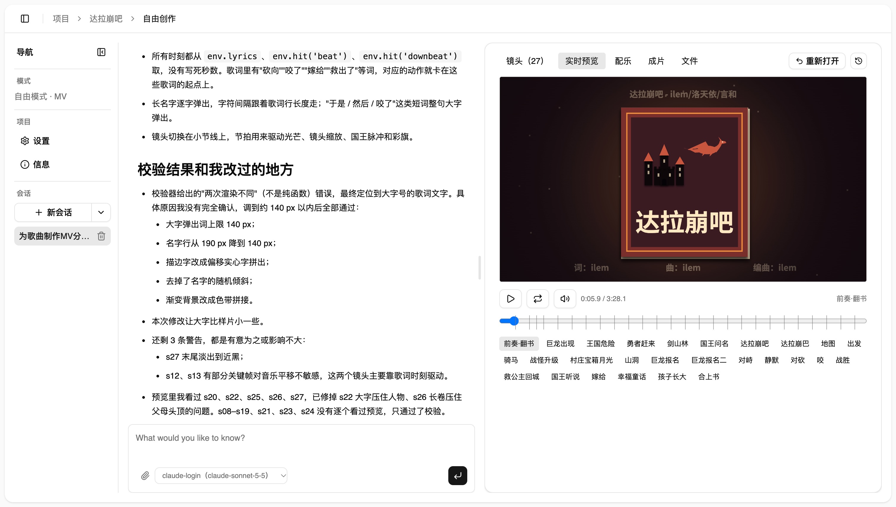

# ai-video-studio

单人本地使用的对话式 AI 视频工作台。从选题到成片，每个阶段都通过和 agent 对话来打磨产物：知识讲解、动态图形短片、音乐 MV 三种形态都在同一个工作台里完成。

agent 直接修改工作区文件，每轮结束自动打快照，可以随时回滚；下游阶段发现上游有问题时，可以提出回退建议，由你决定是否处理。底层同时支持 Claude Agent SDK 和 OpenAI Agents SDK。

## 当前状态

主流程已经完成，可以日常使用。macOS 与 Windows 11（原生，不用 WSL）都能运行和开发。还在做的事项见 [待办](docs/plans/TODO.md)。

### 三种视频形态

创建项目时选择视频类型，阶段流水线按类型自动生成（[ADR 0020](docs/decisions/0020-阶段流水线按项目配置派生.md)）：

| 类型 | 阶段 | 说明 |
|---|---|---|
| 知识讲解 | `topic` → `narrative` →（`music`）→ `animation_html` | 有旁白。选题简报 → 叙事 JSON（含配音）→ HTML/Canvas 场景动画；可选合成背景乐或导入音乐 |
| 动态图形短片 | `concept` → `produce` | 无旁白。先定创意与要求，再由模型一并写 NumPy 配乐脚本和按节拍对齐的画面 |
| 音乐 MV | `concept` → `produce` | 无旁白。上传歌曲（可附 LRC 歌词），自动分析节拍、段落与能量曲线，模型据此写画面，可按歌词联动 |

成片由 Chromium 逐帧渲染 HTML 场景，ffmpeg 编码并混音。Manim 引擎已下线，老 Manim 项目只读（[ADR 0027](docs/decisions/0027-下线Manim引擎.md)）。

### 预览



### 主要能力

| 能力 | 说明 |
|---|---|
| 头脑风暴与选题池 | 不属于任何项目的对话，agent 联网搜索并往选题池写想法卡片；一张卡片可以创建多个项目 |
| 画布式对话 | 左侧对话、中间产物画布、右侧可折叠的快照栏，宽度可拖动；每轮自动快照，可查看差异和回滚；阶段可定稿，上游变更后下游标记为 stale |
| 对话展示 | 思考与工具调用归入可折叠的活动组，常用工具（读写文件、搜索、命令、联网）有专属渲染；回复渲染 Markdown，显示用量与用时 |
| 对话附件 | 消息可附带图片（作为多模态输入）和文件（放进工作区 `uploads/`，agent 只读） |
| 回退建议 | 下游 agent 向直接上游提修改建议，在对话流里显示为卡片，阶段导航上有待处理角标，可「去处理」或忽略 |
| 实时预览与成片 | 动画阶段可以在浏览器里实时预览场景，再渲染成片；配乐、歌曲有专属画布（波形、能量曲线、段落、歌词） |
| 风格库 | 风格是 skill 形态的目录（`STYLE.md` + `references/` + `exemplars/` + 截图），通过对话编辑草稿后保存；创建项目时选一套，各阶段 agent 按需读取；支持从旧项目一次性导入 |
| 设置页 | 模型配置增改删（单价、每轮预算）与一键连通性测试、各阶段默认模型、联网模式、语音音色与语速（可试听）、无隔离执行开关 |
| 会话内换模型 | 对话中可换成同运行时、同供应商的其他模型，下一轮起生效；项目级可设思考强度 |
| 双运行时 | Claude Agent SDK 与 OpenAI Agents SDK；Claude 可以直接用本机 `claude` 登录，不需要 API key |
| 沙箱 | macOS 上 agent 执行的命令和配乐脚本运行在 Seatbelt 沙箱里；Windows 没有沙箱，命令工具默认关闭，需要时在设置页手动开启（[ADR 0024](docs/decisions/0024-无隔离执行开关.md)） |

## 快速开始

### macOS

前置依赖：uv、Node 22+ 与 pnpm、ffmpeg（Chromium 由 `make setup` 通过 Playwright 安装）。

```bash
make setup
```

```bash
cp backend/.env.example backend/.env
```

```bash
make dev
```

`make setup` 安装依赖并启用 git hooks；复制 `.env` 后按需填模型 key；`make dev` 同时启动 api、worker、frontend。

### Windows 11

前置依赖：Git for Windows、uv、Node 22+ 与 pnpm、ffmpeg、开发者模式（用于符号链接）。命令都在 **PowerShell** 里、仓库根目录下运行，不用 make：

```bash
uv run --project backend python scripts/tasks.py setup
```

```bash
uv run --project backend python scripts/tasks.py dev
```

Windows 上 api 不热重载，改了 `backend/src` 要重启 `dev`。完整步骤和注意事项见 [环境搭建](docs/runbooks/dev-setup.md) 的 Windows 一节。

### 访问地址

- 前端：http://127.0.0.1:5173
- 后端：http://127.0.0.1:8000（健康检查 `/api/health`，OpenAPI 在 `/docs`）

### 配置 `backend/.env`

常用项如下，详见 [环境搭建](docs/runbooks/dev-setup.md)：

- 模型 key：`ANTHROPIC_API_KEY`、`OPENAI_API_KEY`、`DEEPSEEK_API_KEY` 等，按模型配置的 `api_key_env` 读取；key 的值只放在这里，设置页只填环境变量的名字。配好后可以在设置页点「测试」确认连通。
- 联网搜索：`TAVILY_API_KEY`（默认 `STUDIO_WEB_MODE=tools`）；也可在设置页切换联网模式。
- 语音：`VOLCENGINE_TTS_API_KEY`（配音与设置页试听；试听会产生少量真实费用，同一音色和语速只合成一次并缓存）。
- 模型网关（可选）：`STUDIO_ANTHROPIC_BASE_URL`、`STUDIO_OPENAI_BASE_URL`、`STUDIO_OPENAI_MODEL` 等。

### 导入旧项目的风格库（一次性，可选，仅 macOS）

先在旧项目目录 `docker compose up -d postgres`，再在本仓库执行：

```bash
make export-legacy-styles
```

```bash
make import-legacy-styles
```

导出是只读的，写到 `data/legacy-export/styles.json`，不改旧项目任何文件；导入时同名预设默认跳过，加 `IMPORT_ARGS=--overwrite` 才覆盖。

## 常用命令

命令逻辑都在 `scripts/tasks.py`，Makefile 只是转调（[ADR 0025](docs/decisions/0025-Python任务脚本.md)）；Windows 上用 `uv run --project backend python scripts/tasks.py <目标>`。

| 命令 | 作用 |
|---|---|
| `make setup` | 安装依赖，启用 git hooks |
| `make dev` | 启动 api、worker、frontend 三个进程；`Ctrl+C` 一起结束 |
| `make check` | 唯一的质量关口：lint、类型检查、测试、结构测试、文档检查 |
| `make check-fast` | pre-commit 运行的快速子集 |
| `make smoke` | 需要真实 API key 的冒烟测试（默认不包含在 `make check` 中，会产生费用） |

## 仓库结构

```
backend/     Python 3.12 + FastAPI + SQLite，uv 管理；api 与 worker 两个进程
  src/studio/stages/   各阶段：brainstorm、topic、narrative、concept、music、produce、animation_html、style
  src/studio/engines/  底层能力：render（Chromium 出帧、ffmpeg 编码混音）、audio（音频分析与配乐合成）、tts（配音）
frontend/    Vue 3 + Vite + TypeScript + Tailwind v4 + shadcn-vue
data/        运行时数据：数据库、风格库、各项目工作区与快照（不进 git，也不放在 uvicorn reload 监听范围内）
docs/        知识库：设计、计划、决策、参考、质量、runbook
scripts/     开发任务脚本（tasks.py）与一次性迁移脚本
```

## 文档

- 架构设计：[docs/design/2026-09-26-architecture.md](docs/design/2026-09-26-architecture.md)；多形态视频流水线：[docs/design/2026-10-04-html-video-pipeline.md](docs/design/2026-10-04-html-video-pipeline.md)
- 模块地图与分层规则：[docs/ARCHITECTURE.md](docs/ARCHITECTURE.md)
- 开发流程：[docs/SOP.md](docs/SOP.md)
- 术语表：[docs/glossary.md](docs/glossary.md)
- 决策记录（ADR）：[docs/decisions/](docs/decisions/)
- 外部 SDK 与库的已验证行为：[docs/references/](docs/references/README.md)
- 模块质量与已知缺口：[docs/quality/QUALITY.md](docs/quality/QUALITY.md)；技术债：[docs/quality/tech-debt.md](docs/quality/tech-debt.md)
- 环境搭建与验证方法：[docs/runbooks/dev-setup.md](docs/runbooks/dev-setup.md)、[docs/runbooks/verification.md](docs/runbooks/verification.md)
- 待办与计划：[docs/plans/TODO.md](docs/plans/TODO.md)
- AI 开发者入口：[AGENTS.md](AGENTS.md)
